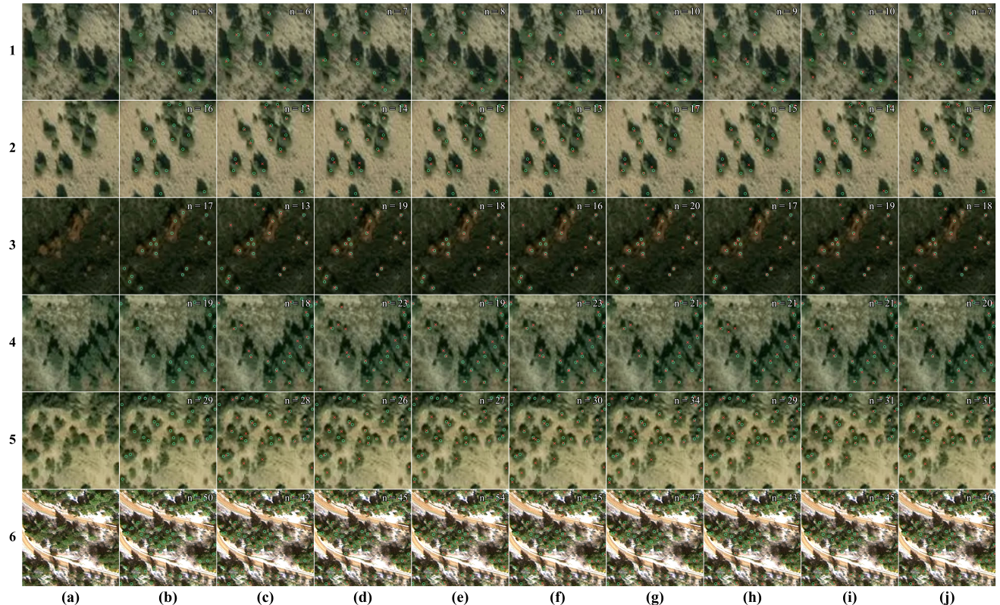
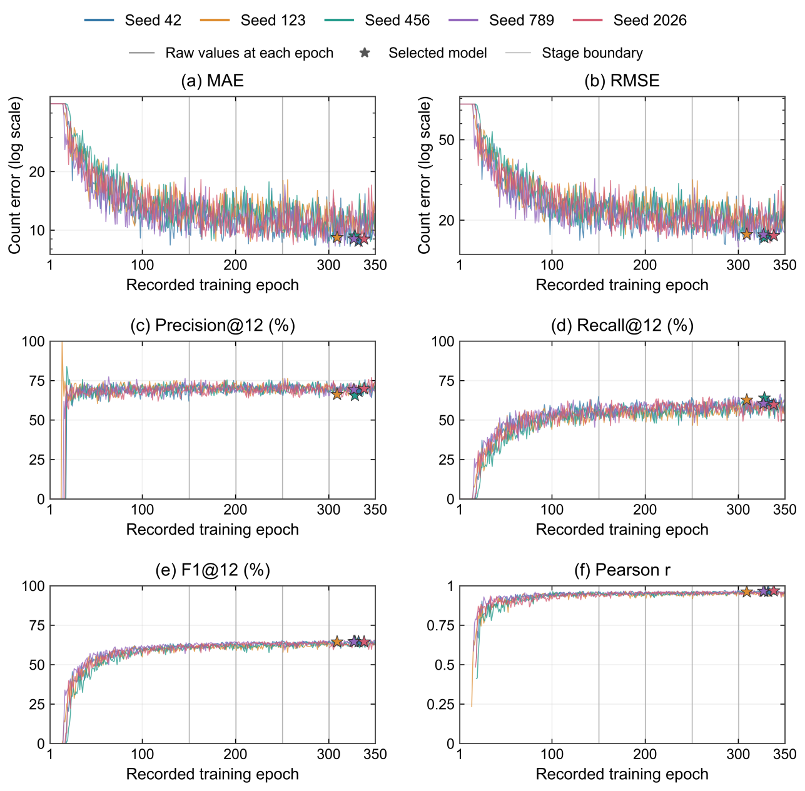
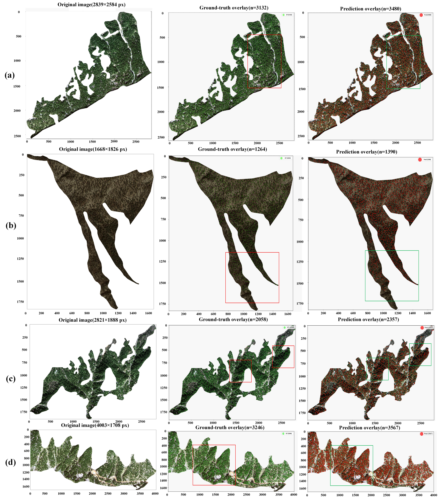

# FSNet

Spatial detail meets frequency context for tree crown detection and counting.

Code, MT-Set data, pretrained models, and paper results for FSNet tree crown detection and counting.

[Download data and trained models](https://github.com/shenjia-eng/FSNet/releases/tag/v1.0.0) · [Dataset guide](docs/DATASETS.md) · [Training and evaluation](docs/REPRODUCIBILITY.md)

## Paper figures

### FSNet ablation results

[](assets/figures/fsnet-ablation-predictions.png)

Six MT-Set scenes. Columns: (a) input, (b) ground truth, (c) Backbone, (d) FSC, (e) SDS, (f) GDR, (g) SDS+GDR, (h) FSC+GDR, (i) SDS+FSC, and (j) FSNet. Green circles show annotations; red crosses show predicted tree crown centers.

### Training across five random seeds

[](assets/figures/five-seed-training-curves.png)

The full training process for seeds 42, 123, 456, 789, and 2026: MAE, RMSE, precision, recall, F1, and Pearson correlation. Stars mark the selected models.

### Whole-scene tree crown detection

[](assets/figures/whole-scene-detection.png)

Four forest scenes, each showing the original image, manual annotations, and FSNet predictions from left to right.

## Contents

| Material | Location |
|---|---|
| Model, training and evaluation code | `vendor/fsnet/`, `scripts/train.py`, `scripts/evaluate.py` |
| Training configurations (mt-set-2074-228-v2) | `configs/stages_v2/42/` |
| Pretrained-model configurations | `configs/fsnet_seed<seed>.json`, `model_manifest.json` |
| Exact image/annotation manifests and splits | `data/data_manifest.json` |
| Trained checkpoint downloads and checksums | `model_manifest.json` and GitHub Releases |
| MT-Set data download and checksums | GitHub Releases; see [data instructions](docs/DATASETS.md) |
| Recorded per-seed and full training-curve results | `results/` |
| Training and evaluation | [docs/REPRODUCIBILITY.md](docs/REPRODUCIBILITY.md) |

Download dataset ZIPs and model checkpoints from [Releases](https://github.com/shenjia-eng/FSNet/releases/tag/v1.0.0).

## Quick start

On Linux, download all three dataset ZIPs and extract them into the same directory. Pass the resulting `mt-set/` folder as `--data-root`, and place model checkpoints in `weights/`.

To verify all downloaded assets while they are in one directory, run `python scripts/verify_assets.py /path/to/downloads`.

```bash
python -m pip install -r requirements.txt
python scripts/evaluate.py --config configs/fsnet_seed42.json --checkpoint weights/fsnet_seed42.pth --manifest data/data_manifest.json --split validation --data-root /path/to/mt-set --output outputs/validation42 --device cuda
```

Use `--device cpu` for CPU evaluation. See the [dataset guide](docs/DATASETS.md) for data splits and formats.

The training CLI supports seed42. Evaluation configurations and pretrained weights are provided for all five seeds.

## Reported results

Five seeds: 42, 123, 456, 789, 2026. Values are mean ± sample standard deviation. Localization uses 12 pixels; confidence is strictly greater than 0.5.

| Model | MAE | RMSE | Precision (%) | Recall (%) | F1 (%) |
|---|---:|---:|---:|---:|---:|
| FSNet |9.064 ± 0.213|16.780 ± 0.242|67.826 ± 1.908|61.641 ± 1.720|64.546 ± 0.143|

Per-seed results and training curves are available in `results/`.

## License and attribution

Code: [academic research](LICENSE). Data: [CC BY-NC 4.0](LICENSE_DATA.md). Weights: [research use](LICENSE_WEIGHTS.md). See [third-party notices](THIRD_PARTY_NOTICES.md) and [citation information](CITATION.cff).
